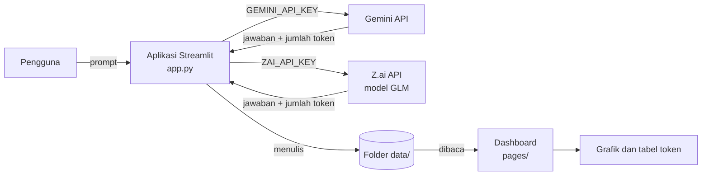

# PANDU (AI Token Lab)

Aplikasi chatbot teks berbasis **Google Gemini** dan **GLM (Z.ai)** untuk **eksperimen penggunaan token**. Setiap percobaan mencatat token input, output, dan thinking, lalu hasilnya dipakai untuk membandingkan struktur prompt, teknik prompting, dan model.

> Tugas kelompok mata kuliah **Pengembangan Sistem Cerdas**.

## Anggota dan pembagian tugas

| Nama | NIM | Bagian |
|---|---|---|
| Steven Teody Budiono | 2313030059 | Pembuatan aplikasi di Streamlit (`app.py`) dan repositori |
| Satria Sinak | 2313030101 | Pembuatan dashboard di Streamlit (`pages/`) |
| Bintang Perdana Yulianto Putra | 2313030016 | Eksperimen prompt: menjalankan 28 kombinasi prompt lewat aplikasi Streamlit dan mencatat hasil serta deskripsi kualitasnya |

## Tujuan

Mengetahui bagaimana kombinasi struktur prompt (persona, format, batasan, konteks, dan lain-lain) dan teknik prompting (zero-shot, few-shot, chain of thought, dan lain-lain) memengaruhi **jumlah token** dan **kualitas jawaban** model.

## Struktur proyek

```
.
├── app.py                  # aplikasi utama (mode Chat dan Eksperimen)
├── pages/
│   └── 1_Dashboard.py      # halaman dashboard
├── gambar/
│   └── 1.png               # logo aplikasi
├── .streamlit/
│   └── config.toml         # tema tampilan
├── data/                   # file catatan yang dibuat otomatis oleh aplikasi
├── cek_key.py              # skrip bantu untuk memeriksa API key
├── requirements.txt        # daftar library
└── .gitignore
```

File `.env` (berisi API key) ada di komputer masing-masing dan **tidak ikut diupload** ke GitHub.

## Arsitektur



| Komponen | Fungsi |
|---|---|
| `app.py` | Aplikasi utama: mode **Chat** (dengan riwayat obrolan) dan mode **Eksperimen** (mengirim prompt, menampilkan jawaban dan token, menyimpan log) |
| `pages/1_Dashboard.py` | Dashboard token dan jatah request (dibaca dari folder `data/`) |
| `data/` | File catatan yang ditulis aplikasi (lihat bagian Format data) |
| `.env` | Menyimpan API key milik masing-masing anggota (tidak ikut diupload) |
| `requirements.txt` | Daftar library beserta versinya |

## Fitur

**Dua mode di sidebar**

- **Chat**: mengobrol dengan persona tetap (pemandu wisata Yogyakarta yang ramah). Obrolan tersimpan sebagai riwayat dan bisa dibuka atau dihapus lagi dari sidebar. Tersedia sakelar **Pencarian web** untuk pertanyaan yang butuh informasi terbaru.
- **Eksperimen**: mengirim prompt apa adanya (tanpa persona tambahan) bersama **nomor kombinasi**, lalu mencatat token dan penilaian kualitas ke log.

**Fitur lain**

- Dua model yang bisa dipilih di sidebar (**Model**): `gemini-3.8-flash` (Gemini) dan `glm-4.7-flash` (Z.ai).
- Pencatatan token input, output, thinking, dan total untuk setiap request.
- Pemantauan batas request (RPD, RPM) dan token masuk per menit (TPM), dengan peringatan kalau hampir atau sudah melewati batas.
- **Hitungan jatah request dipisah per API key**: ganti API key berarti hitungan RPD/RPM/TPM mulai dari 0 lagi untuk key itu.
- Request yang gagal karena server sibuk (misalnya kode 5xx atau 1305/1302 pada Z.ai) dicoba ulang otomatis beberapa kali.
- Log eksperimen bisa dilihat dan diunduh dalam bentuk CSV.

## Cara kerja (mode Eksperimen)

1. Pengguna mengisi **nomor kombinasi** dan **prompt**, lalu menekan **Kirim ke Gemini** (atau **Kirim ke GLM**, tergantung model yang dipilih).
2. Aplikasi mengirim prompt sebagai percakapan baru (tanpa riwayat), supaya token input hanya berasal dari prompt itu.
3. Model mengembalikan jawaban dan data penggunaan token (input, output, thinking, total).
4. Aplikasi menampilkan jawaban dan token, lalu pengguna menulis **deskripsi kualitas** hasil.
5. Setelah menekan **Simpan ke log**, satu baris ditulis ke `data/log.csv`.
6. Setiap request yang berhasil juga dicatat di `data/pemakaian.csv` (dipakai untuk menghitung token masuk per menit) walaupun hasilnya tidak disimpan ke log.
7. Dashboard membaca file di `data/` dan menampilkan ringkasan, grafik, serta tabel.

## Library yang dipakai

| Library | Versi | Fungsi |
|---|---|---|
| `streamlit` | 1.65.0 | Tampilan web aplikasi dan dashboard |
| `google-genai` | 2.29.0 | Menghubungi Gemini API |
| `requests` | sesuai `requirements.txt` | Menghubungi API Z.ai untuk model GLM |
| `pandas` | 3.0.6 | Membaca dan menulis log CSV serta mengolah data |
| `plotly` | 7.1.0 | Grafik pada dashboard |
| `python-dotenv` | 1.2.4 | Membaca API key dari file `.env` |
| `tzdata` | 2026.5 | Data zona waktu (hari Google mengikuti waktu Pasifik), dibutuhkan di Windows |

Library lain yang terlihat di `pip list` (misalnya `numpy`, `httpx`, `pydantic`) terpasang otomatis sebagai pendukung library di atas, sehingga tidak perlu ditulis satu per satu.

## Cara menjalankan

Prasyarat:

- **Python 3.11 atau lebih baru** (centang *Add Python to PATH* saat instalasi di Windows).
- **Git** untuk mengunduh proyek.
- API key Gemini milik sendiri dari <https://aistudio.google.com/apikey>.
- (Opsional) API key Z.ai kalau ingin memakai model GLM.

**1. Unduh proyek**

```
git clone https://github.com/Steventeody/tugas_Pengembangan_Sistem-Cerdas.git
cd tugas_Pengembangan_Sistem-Cerdas
```

**2. Pasang library**

```
pip install -r requirements.txt
```

**3. Siapkan API key**

Buat file baru bernama `.env` di folder yang sama dengan `app.py`, lalu isi dengan key milik sendiri:

```
GEMINI_API_KEY=isi_key_gemini_kamu_di_sini
ZAI_API_KEY=isi_key_zai_kamu_di_sini
```

`ZAI_API_KEY` hanya perlu diisi kalau kamu memilih model GLM. Setelah mengubah `.env`, jalankan ulang Streamlit.

**4. Jalankan aplikasi**

```
streamlit run app.py
```

Aplikasi terbuka di browser (biasanya <http://localhost:8501>). Halaman **Dashboard** muncul di menu samping.

> Tiap anggota memakai API key **sendiri**. Jangan pernah menaruh key di kode, di README, atau mengunggah file `.env`.

### Kalau ada masalah

| Masalah | Penyebab dan solusi |
|---|---|
| `streamlit` tidak dikenali | Library belum terpasang. Jalankan `pip install -r requirements.txt` (langkah 2). |
| Muncul pesan "API key belum ditemukan" | File `.env` belum dibuat, salah letak, atau nama variabelnya salah. Pastikan `GEMINI_API_KEY` (atau `ZAI_API_KEY` untuk GLM) ada di `.env` satu folder dengan `app.py`, lalu jalankan ulang Streamlit. |
| Error 429 / jatah habis | Batas request (RPD/RPM) tercapai. Tunggu 1 menit, atau coba lagi besok kalau batas hariannya yang habis. |
| GLM kadang gagal dengan kode 1305 atau 1302 | Server Z.ai sedang sibuk. Aplikasi mencoba ulang otomatis; kalau tetap gagal, kirim lagi beberapa saat kemudian. |
| Nama model ditolak | Nama model di aplikasi tidak lagi tersedia di penyedia. Cek nama model terbaru di dokumentasi Gemini atau Z.ai. |
| Angka jatah request berbeda dengan dashboard penyedia | Aplikasi hanya menghitung request yang lewat aplikasi ini. Pemakaian di luar aplikasi (misalnya langsung di AI Studio) tidak ikut terhitung. |

## Format data

File berikut ditulis otomatis oleh aplikasi di folder `data/`. API key tidak pernah ditulis di file-file ini (hanya kode hash pendek).

**`data/log.csv`** berisi hasil eksperimen yang disimpan, satu baris per percobaan. File ini ikut diupload ke GitHub sebagai bukti hasil eksperimen.

| Kolom | Arti |
|---|---|
| `waktu`, `anggota`, `model` | Waktu, nama pengguna, dan model yang dipakai |
| `jenis` | `eksperimen` atau `chat` |
| `nomor_kombinasi` | Nomor kombinasi pada tabel dosen (untuk chat berisi `chat`) |
| `persona` | Persona yang dipakai: kalimat persona dari prompt (eksperimen) atau `Tanpa persona` |
| `prompt`, `jawaban` | Prompt yang dikirim dan jawaban model |
| `input_tokens`, `output_tokens`, `thinking_tokens`, `total_tokens` | Token yang dilaporkan API |
| `temperature`, `top_p`, `top_k` | Parameter sampling (kosong berarti nilai bawaan model; aplikasi tidak lagi mengaturnya manual) |
| `kualitas` | Penilaian kualitas oleh pengguna |
| `total_kumulatif` | Total token yang menumpuk sampai baris itu |

**`data/pemakaian.csv`** mencatat token semua request yang berhasil, disimpan atau tidak (kolom: `waktu`, `model`, `anggota`, `kunci`, `input_tokens`, `output_tokens`, `thinking_tokens`, `total_tokens`). Kolom `kunci` berisi kode pendek hasil hash dari API key, bukan key aslinya.

**`data/request_hits.txt`** mencatat waktu setiap request yang dikirim ke model, termasuk yang gagal atau diulang, dengan format `waktu|kode_key`.

**`data/pengaturan.json`** menyimpan batas request (RPD, RPM, TPM) untuk tiap penyedia serta penyesuaian jatah per API key.

**`data/riwayat_chat.json`** menyimpan riwayat obrolan mode Chat. File ini hanya ada di komputer masing-masing dan **tidak ikut diupload** ke GitHub karena berisi isi percakapan.

## Topik dan persona chatbot

- **Topik:** wisata Yogyakarta.
- **Persona:** pemandu wisata yang ramah dan penuh semangat. Pada mode Chat, persona ini dipasang tetap sebagai instruksi sistem.
- Pada mode Eksperimen, persona (kalau ada) ditulis langsung di dalam teks prompt, pada kombinasi yang memuat elemen *Persona/role* (nomor 3, 3.2, 4, 4.2, 5, 5.2, 6, 6.2, 9.2, 13.2, 14, 14.2). Kombinasi lain tidak memakai persona.
- Aplikasi mencatat persona di kolom `persona` pada log: kalimat pertama prompt yang diawali "Kamu adalah ..." atau "Tanpa persona".

## Metode eksperimen

- Mengikuti **28 kombinasi** pada tabel dosen (nomor 1 sampai 14.2): gabungan struktur prompt (A) dan teknik prompting (B).
- Tiap percobaan dikirim sebagai percakapan baru.
- Model, parameter sampling (bawaan), dan topik dijaga sama di semua baris supaya perbandingan adil.
- Kualitas dinilai oleh anggota kelompok dengan rubrik: kesesuaian dengan tugas, struktur atau format, kepatuhan terhadap larangan, dan panjang jawaban.
- Model yang dipakai pada tabel hasil di bawah: **gemini-3.8-flash**, dijalankan pada **12 sampai 14 Oktober 2026**.

## Hasil

Token tiap kombinasi (dari `data/log.csv`):

| Nomor | Token input | Token output | Token thinking | Total token |
|---|---|---|---|---|
| 1 | 16 | 766 | 995 | 1.777 |
| 1.2 | 21 | 997 | 919 | 1.937 |
| 2 | 15 | 296 | 768 | 1.079 |
| 2.2 | 23 | 313 | 1.110 | 1.446 |
| 3 | 21 | 1.155 | 1.084 | 2.260 |
| 3.2 | 26 | 926 | 876 | 1.828 |
| 4 | 44 | 335 | 738 | 1.117 |
| 4.2 | 36 | 372 | 797 | 1.205 |
| 5 | 68 | 1.486 | 1.065 | 2.619 |
| 5.2 | 58 | 1.347 | 1.669 | 3.074 |
| 6 | 80 | 1.333 | 1.309 | 2.722 |
| 6.2 | 68 | 955 | 1.090 | 2.113 |
| 7 | 47 | 30 | 569 | 646 |
| 7.2 | 56 | 31 | 698 | 785 |
| 8 | 100 | 16 | 621 | 737 |
| 8.2 | 105 | 12 | 784 | 901 |
| 9 | 95 | 94 | 2.116 | 2.305 |
| 9.2 | 80 | 214 | 558 | 852 |
| 10 | 163 | 116 | 1.026 | 1.305 |
| 10.2 | 146 | 92 | 1.048 | 1.286 |
| 11 | 128 | 294 | 1.161 | 1.583 |
| 11.2 | 128 | 312 | 1.023 | 1.463 |
| 12 | 116 | 945 | 901 | 1.962 |
| 12.2 | 121 | 945 | 1.101 | 2.167 |
| 13 | 133 | 576 | 1.314 | 2.023 |
| 13.2 | 113 | 1.139 | 1.055 | 2.307 |
| 14 | 65 | 829 | 871 | 1.765 |
| 14.2 | 70 | 669 | 1.203 | 1.942 |
| **Jumlah** | **2.142** | **16.595** | **28.469** | **47.206** |

**Temuan utama**

- Token input terbesar ada pada kombinasi 10 (163 token) dan 10.2 (146 token), yaitu prompt yang memuat tiga gaya contoh sekaligus (tanpa contoh, satu contoh, tiga contoh).
- Token output terbesar ada pada kombinasi 5 (1.486 token) dan 5.2 (1.347 token), yaitu itinerari 3 hari bertahap. Token output terkecil ada pada kombinasi 8.2 (12 token) dan 8 (16 token), yaitu permintaan satu slogan.
- Token thinking terbesar ada pada kombinasi 9 (2.116 token) padahal outputnya hanya 94 token. Jadi panjang jawaban tidak selalu menggambarkan banyaknya token yang terpakai.
- Total token terbesar ada pada kombinasi 5.2 (3.074 token) dan terkecil pada kombinasi 7 (646 token).
- Token thinking (28.469) lebih besar daripada token output (16.595) dan token input (2.142) jika dijumlahkan seluruh percobaan.

**Kesimpulan:** Jenis tugas pada prompt sangat memengaruhi token output (artikel dan itinerari panjang, slogan pendek), sedangkan penambahan contoh pada prompt menaikkan token input. Karena tugasnya berbeda antar kelompok kombinasi, perbandingan paling adil dilakukan antara kombinasi dengan tugas yang sama (misalnya 1 dengan 1.2, atau 3 dengan 3.2).

## Dashboard

Halaman **Dashboard PANDU** membaca file di `data/`. Filter di sidebar: **Jenis**, **Penyedia**, **Model**, dan **Jatah request untuk** (memilih penyedia yang jatahnya ditampilkan). Isinya terbagi dalam lima tab:

- **Ringkasan**: jumlah percobaan, total dan rata-rata token, rasio output+thinking terhadap input, jatah request harian (RPD, RPM, TPM), token per hari, proporsi token input/output/thinking, dan total token yang menumpuk.
- **Per model**: perbandingan rata-rata dan total token antar model (Gemini dan GLM).
- **Per kombinasi**: rata-rata token untuk tiap nomor kombinasi.
- **Analisis**: hubungan token input dengan jumlah elemen struktur prompt, token output dan thinking dengan jumlah teknik prompting, serta sebaran token input terhadap output + thinking.
- **Data**: tabel log lengkap dan tombol unduh CSV.

Angka batas RPD, RPM, dan TPM bawaan hanyalah perkiraan. Cocokkan dengan halaman batas kecepatan di AI Studio (Gemini) atau dashboard Z.ai (GLM).

## Keterbatasan

- Jumlah percobaan per kombinasi sedikit (satu kali), sehingga hasil bisa berbeda jika diulang.
- Penilaian kualitas bersifat subjektif.
- Jatah request harian dibatasi (versi gratis), sehingga eksperimen dijalankan bertahap.
- Penyedia tidak menyediakan cara mengambil sisa kuota lewat API key, sehingga jatah request dihitung dari request yang dikirim lewat aplikasi ini. Pemakaian di luar aplikasi tidak ikut terhitung.
- Model GLM dipanggil tanpa streaming, dan jumlah token thinking bergantung pada data yang dikembalikan Z.ai, sehingga bisa berbeda cara hitungnya dengan Gemini.
- Hasil berlaku untuk model dan tanggal yang dicatat.
