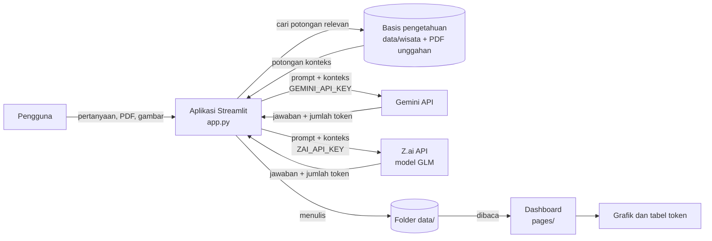

# PANDU (AI Token Lab)

Aplikasi chatbot teks berbasis **Google Gemini** dan **GLM (Z.ai)** untuk **eksperimen penggunaan token**. Setiap percobaan mencatat token input, output, dan thinking, lalu hasilnya dipakai untuk membandingkan struktur prompt, teknik prompting, model, dan **penggunaan RAG** (jawaban dengan dan tanpa konteks dari basis pengetahuan).

> Tugas kelompok mata kuliah **Pengembangan Sistem Cerdas**.

## Anggota dan pembagian tugas

| Nama | NIM | Bagian |
|---|---|---|
| Steven Teody Budiono | 2313030059 | Pembuatan aplikasi di Streamlit (`app.py`) dan repositori |
| Satria Sinak | 2313030101 | Pembuatan dashboard di Streamlit (`pages/`) |
| Bintang Perdana Yulianto Putra | 2313030016 | Eksperimen prompt: menjalankan 28 kombinasi prompt lewat aplikasi Streamlit dan mencatat hasil serta deskripsi kualitasnya |

## Tujuan

1. Mengetahui bagaimana kombinasi struktur prompt (persona, format, batasan, konteks, dan lain-lain) dan teknik prompting (zero-shot, few-shot, chain of thought, dan lain-lain) memengaruhi **jumlah token** dan **kualitas jawaban** model.
2. Mengetahui bagaimana **RAG** (Retrieval-Augmented Generation) memengaruhi jumlah token dan ketepatan jawaban dibanding menjawab tanpa konteks tambahan.

## Struktur proyek

```
.
├── app.py                  # aplikasi utama (mode Chat dan Eksperimen)
├── pages/
│   └── 1_Dashboard.py      # halaman dashboard
├── data/
│   ├── wisata/             # basis pengetahuan RAG (file .md), ditulis dan diubah manual
│   └── ...                 # file catatan yang dibuat otomatis oleh aplikasi
├── evaluasi_rag.py         # evaluasi kualitas pencarian RAG (Hit@k, MRR, dan lain-lain)
├── tes_rag.py              # tes unit untuk fungsi pencarian RAG
├── gambar/
│   └── 1.png               # logo aplikasi
├── .streamlit/
│   └── config.toml         # tema tampilan
├── cek_key.py              # skrip bantu untuk memeriksa API key
├── requirements.txt        # daftar library
└── .gitignore
```

File `.env` (berisi API key) ada di komputer masing-masing dan **tidak ikut diupload** ke GitHub.

## Arsitektur



| Komponen | Fungsi |
|---|---|
| `app.py` | Aplikasi utama: mode **Chat** (riwayat obrolan, RAG, dokumen, gambar) dan mode **Eksperimen** (mengirim prompt, menampilkan jawaban dan token, menyimpan dan mengelola log) |
| `pages/1_Dashboard.py` | Dashboard token, termasuk tab **RAG** (dibaca dari folder `data/`) |
| `data/wisata/` | Basis pengetahuan RAG: file `.md` berisi data wisata |
| `data/` | File catatan yang ditulis aplikasi (lihat bagian Format data) |
| `evaluasi_rag.py`, `tes_rag.py` | Evaluasi dan tes untuk pencarian RAG |
| `.env` | Menyimpan API key milik masing-masing anggota (tidak ikut diupload) |
| `requirements.txt` | Daftar library beserta versinya |

## Fitur

**Dua mode di sidebar**

- **Chat**: mengobrol dengan persona **PANDU**, pemandu wisata digital yang ramah. Obrolan tersimpan sebagai riwayat dan bisa dicari, diganti namanya, diunduh (Markdown), dibuka, atau dihapus lagi dari sidebar. Tersedia sakelar **Pakai RAG** untuk menjawab berdasarkan basis pengetahuan.
- **Eksperimen**: mengirim prompt apa adanya (tanpa persona tambahan) bersama **nomor kombinasi**, lalu mencatat token dan penilaian kualitas ke log.

**Fitur lain**

- Dua model yang bisa dipilih di sidebar (**Model**): `gemini-3.8-flash` (Gemini) dan `glm-4.7-flash` (Z.ai).
- Pencatatan token input, output, thinking, dan total untuk setiap request.
- **RAG data wisata**: potongan dari file di `data/wisata` ditempel ke prompt, lengkap dengan info jumlah potongan yang terkirim.
- **Dokumen unggahan**: PDF atau teks bisa diunggah sebagai konteks tambahan (hanya di memori per obrolan). Ikut aktif saat sakelar RAG menyala. Tersedia **saran pertanyaan dari dokumen** (satu panggilan model yang tercatat di log).
- **Input gambar** (khusus model Gemini): PNG, JPEG, atau WEBP, maksimal 3 gambar dan 4 MB per gambar. Model GLM yang dipakai hanya menerima teks.
- Pemantauan batas request (RPD, RPM) dan token masuk per menit (TPM), dengan peringatan kalau hampir atau sudah melewati batas.
- **Hitungan jatah request dipisah per API key**: ganti API key berarti hitungan RPD/RPM/TPM mulai dari 0 lagi untuk key itu.
- Request yang gagal karena server sibuk (misalnya kode 5xx atau 1305/1302 pada Z.ai) dicoba ulang otomatis beberapa kali.
- **Log bisa dikelola langsung dari aplikasi** (mode Eksperimen, bagian **Lihat log**): difilter menurut **Sumber** (chat biasa, dokumen, gambar, eksperimen), **RAG** (tanpa atau dengan RAG), dan **Model**; baris terpilih bisa dihapus, atau seluruh log dihapus dengan kotak konfirmasi. Sebelum menghapus, log lama disalin ke `data/log.csv.bak` (hanya satu versi terakhir). Filter hanya mengubah tampilan, bukan isi `log.csv`. `data/pemakaian.csv` (catatan kuota) tidak ikut terhapus.
- Log juga bisa diunduh dalam bentuk CSV.
- **Beberapa API key GLM**: kalau kuota key Z.ai yang aktif habis, aplikasi pindah otomatis ke key berikutnya (lihat bagian Cara menjalankan).
- Nama pengguna **tidak disimpan** di log maupun di dashboard (kolom `anggota` dibiarkan kosong).

## Cara kerja (mode Eksperimen)

1. Pengguna mengisi **nomor kombinasi** dan **prompt**, lalu menekan **Kirim ke Gemini** (atau **Kirim ke GLM**, tergantung model yang dipilih).
2. Aplikasi mengirim prompt sebagai percakapan baru (tanpa riwayat), supaya token input hanya berasal dari prompt itu.
3. Model mengembalikan jawaban dan data penggunaan token (input, output, thinking, total).
4. Aplikasi menampilkan jawaban dan token, lalu pengguna menulis **deskripsi kualitas** hasil.
5. Setelah menekan **Simpan ke log**, satu baris ditulis ke `data/log.csv`.
6. Setiap request yang berhasil juga dicatat di `data/pemakaian.csv` (dipakai untuk menghitung token masuk per menit) walaupun hasilnya tidak disimpan ke log.
7. Dashboard membaca file di `data/` dan menampilkan ringkasan, grafik, serta tabel.

## RAG (Retrieval-Augmented Generation)

### Arsitektur

```
Pertanyaan pengguna
      │
      ▼
 [Pengambilan]  cari_konteks()  ── BM25 di atas potongan data/wisata/*.md
      │            + (opsional) potongan dokumen unggahan pengguna
      ▼
 [Penyusunan]   susun_prompt_rag()  ── konteks + pertanyaan ditempel ke prompt
      │
      ▼
 [Pembangkitan] model LLM (Gemini / GLM) menjawab berdasarkan konteks
      │
      ▼
 Jawaban + info jumlah potongan → dicatat di log
```

- **Basis pengetahuan**: file `.md` atau `.txt` di `data/wisata` (kota yang tercakup: Yogyakarta, Bali, Bandung, Malang, Kediri, ditambah info praktis, kuliner, dan info umum). Tidak ada database. Menambah pengetahuan cukup menambah atau mengubah file.
- **Potongan (chunk)**: tiap judul `## ...` menjadi satu potongan. Baris `Kata kunci:` ikut diindeks untuk pencarian tetapi tidak dikirim ke model.
- **Pengindeks**: BM25 murni Python (k1 = 1,5; b = 0,75), tanpa dependensi tambahan. Indeks dibangun ulang otomatis saat file di `data/wisata` berubah.
- **Metode pencarian**: BM25 (dipakai di aplikasi). Pencarian semantik dengan embedding Gemini (`gemini-embedding-001`) tersedia di kode (`RAG_METODE_TETAP`), dengan cadangan otomatis ke BM25 kalau embedding gagal. Ambang semantik belum dikalibrasi (jalankan `python evaluasi_rag.py --semantik`).
- **Pengaman pencarian**:
  - `RAG_SKOR_MIN = 1.0`: skor tertinggi di bawah ini berarti tidak ada konteks yang ditempel.
  - `RAG_REL = 0.45`: potongan lain harus mencapai 45% dari skor tertinggi.
  - Jika pertanyaan menyebut tempat tertentu, hanya potongan tentang tempat itu yang dipakai. Kota yang tidak ada di data (misalnya Tokyo) tidak mendapat konteks kota lain.
  - Pertanyaan umum soal satu kota ("wisata paling populer di Kediri") memakai potongan tempat wisata kota itu menurut urutan di file, tanpa potongan kuliner dan akses. Karena itu urutkan bagian di file `wisata_*.md` dari yang paling utama.
  - Pertanyaan tanpa nama tempat harus cocok dengan minimal dua kata di satu potongan (`RAG_COVER_MIN`), supaya pertanyaan umum yang kebetulan memuat satu kata data wisata tidak ikut menarik konteks.
  - Data wisata tidak berisi harga tiket dan jam buka kecuali yang terverifikasi di `info_umum.md`.
- **Dokumen unggahan**: PDF atau teks, hanya di memori per obrolan (maksimal 5 MB, 3 dokumen, 80 halaman PDF). Isinya dibungkus tag acak dan model diperintahkan memperlakukannya sebagai data, bukan instruksi (mitigasi prompt injection). Pertanyaan yang jelas merujuk ke dokumen ("ringkas dokumen ini") mendapat lebih banyak potongan, dan kalau tidak ada yang cocok, bagian awal dokumen dipakai sebagai cadangan.
- **Sakelar RAG** mengatur data wisata dan dokumen sekaligus: mati berarti tidak ada konteks tambahan sama sekali, hidup berarti dokumen (kalau ada) dan data wisata ikut dicari.

### Cara LLM terhubung dengan basis pengetahuan internal

Model tidak dilatih ulang dan tidak punya koneksi ke database. Hubungannya hanya lewat **prompt**:

1. Sistem mencari potongan yang paling relevan dengan pertanyaan.
2. Potongan itu ditempel ke prompt dengan label `KONTEKS:` di depan `PERTANYAAN:`.
3. Instruksi di prompt meminta model memakai konteks hanya jika sesuai dengan tempat dan topik yang ditanyakan. Jika konteks tidak memuat jawabannya, model diminta mengatakan bahwa datanya tidak ada di basis pengetahuan, lalu menjawab seperlunya dengan pengetahuan umum.
4. Jumlah potongan yang dipakai tampil di bawah jawaban dan dicatat di log (`rag`, `rag_sumber`, `dokumen`, `dokumen_sumber`).

Keuntungannya, pengetahuan mudah diperbarui dan jawabannya bisa ditelusuri ke sumber. Batasannya, jawaban hanya sebaik potongan yang terambil, dan model tetap bisa keliru memakai konteks. Jawaban RAG berlandaskan isi file, tetapi tidak dijamin sama persis dengan isi file.

### Evaluasi kinerja RAG

Jalankan dari folder utama:

```
python evaluasi_rag.py              # ringkasan di terminal
python evaluasi_rag.py --csv        # simpan hasil per pertanyaan
python evaluasi_rag.py --lembar     # lembar penilaian manual
python evaluasi_rag.py --semantik   # bandingkan BM25 dan semantik (butuh GEMINI_API_KEY)
python -m unittest tes_rag -v       # tes unit pencarian (memakai korpus buatan)
```

Evaluasi memakai 61 pertanyaan uji (39 punya jawaban di data, 22 di luar data). Metrik pengambilan:

| Metrik | Arti |
|---|---|
| Hit@1 / Hit@k | potongan yang benar ada di peringkat 1 / di antara k teratas |
| Recall@k | proporsi potongan relevan yang terambil |
| Presisi@k | proporsi potongan terambil yang memang relevan |
| MRR | rata-rata 1/peringkat potongan benar pertama |
| Cakupan | proporsi pertanyaan yang mendapat konteks |
| Penolakan benar | pertanyaan di luar data yang tidak mendapat konteks |
| Kata/pertanyaan | perkiraan beban token input dari RAG |

Hasil terakhir (BM25, k = 3): Hit@1 0,95; Hit@k 1,00; Recall@k 1,00; Presisi@k 0,80; MRR 0,96; Cakupan 1,00; Penolakan benar 0,82.

Empat pertanyaan umum masih menarik potongan yang tidak perlu (cara membuat nasi goreng, terjemahan ke bahasa Inggris, cara membuat kopi, sejarah kemerdekaan Indonesia). Pencarian berbasis kata tidak bisa membedakannya dari pertanyaan wisata. Model diminta mengabaikan konteks yang tidak sesuai, tetapi token inputnya tetap terpakai.

**Catatan jujur**: pertanyaan uji ditulis pengembang setelah membaca data, jumlahnya kecil, dan sebagian ditambahkan untuk menguji perbaikan tertentu. Angka ini menunjukkan pencarian berjalan sesuai desain, bukan akurasi umum. Kualitas **jawaban** (kesetiaan pada konteks, tidak mengarang) tidak diukur otomatis; gunakan `--lembar` untuk penilaian manual.

### Set uji RAG (dengan dan tanpa RAG)

Set uji berisi 10 pertanyaan (7 ada di data wisata, 3 di luar data) yang masing-masing dijalankan dua kali, tanpa RAG lalu dengan RAG. Hasilnya dicatat ke log sebagai jenis `uji_tanpa_rag` dan `uji_rag` (nomor U01 sampai U10), dan tampil berpasangan di **Dashboard, tab RAG**. Prompt dikirim apa adanya (tanpa persona) dan dokumen unggahan tidak dipakai.

Tombol untuk menjalankan set uji sudah **dihapus dari halaman Eksperimen** setelah data percobaan terkumpul. Datanya tetap ada di `data/log.csv` dan tetap dibaca dashboard. Fungsi `jalankan_set_uji()` masih ada di `app.py` (melewati pasangan yang sudah tercatat untuk model yang sama, dan menunggu lalu mencoba lagi bila server GLM sibuk) kalau suatu saat ingin dipasang kembali.

Untuk perbandingan dengan dan tanpa RAG yang baru, gunakan mode **Chat** dengan sakelar RAG menyala dan mati pada pertanyaan yang sama, lalu lihat tab **RAG** dan filter **RAG** di dashboard.

### Menambah data kota baru

1. Buat file baru di `data/wisata`, misalnya `wisata_solo.md`.
2. Tulis tiap topik sebagai `## Judul`, lalu isi yang faktual dan bersumber. Jangan menulis harga tiket atau jam buka di file kota.
3. Tambahkan baris `Kata kunci:` berisi sinonim atau ejaan lain nama tempat.
4. Jalankan `python evaluasi_rag.py`. Tambahkan 3–5 pertanyaan uji untuk kota itu ke `SET_UJI`, lalu pastikan tidak ada yang gagal.
5. Muat ulang aplikasi; indeks diperbarui otomatis.

## Library yang dipakai

| Library | Versi | Fungsi |
|---|---|---|
| `streamlit` | 1.65.0 | Tampilan web aplikasi dan dashboard |
| `google-genai` | 2.29.0 | Menghubungi Gemini API (juga embedding) |
| `requests` | sesuai `requirements.txt` | Menghubungi API Z.ai untuk model GLM |
| `pandas` | 3.0.6 | Membaca dan menulis log CSV serta mengolah data |
| `plotly` | 7.1.0 | Grafik pada dashboard |
| `python-dotenv` | 1.2.4 | Membaca API key dari file `.env` |
| `pypdf` | sesuai `requirements.txt` | Membaca teks dari PDF yang diunggah |
| `tzdata` | 2026.5 | Data zona waktu (hari Google mengikuti waktu Pasifik), dibutuhkan di Windows |

Library lain yang terlihat di `pip list` (misalnya `numpy`, `httpx`, `pydantic`) terpasang otomatis sebagai pendukung library di atas, sehingga tidak perlu ditulis satu per satu. BM25 ditulis sendiri dengan Python biasa, jadi RAG tidak menambah library berat.

## Cara menjalankan

Prasyarat:

- **Python 3.11 atau lebih baru** (centang *Add Python to PATH* saat instalasi di Windows).
- **Git** untuk mengunduh proyek.
- API key Gemini milik sendiri dari <https://aistudio.google.com/apikey>.
- (Opsional) API key Z.ai kalau ingin memakai model GLM.

**1. Unduh proyek**

```
git clone https://github.com/Steventeody/tugas_Pengembangan_Sistem-Cerdas.git
cd tugas_Pengembangan_Sistem-Cerdas
```

**2. Pasang library**

```
pip install -r requirements.txt
```

**3. Siapkan API key**

Buat file baru bernama `.env` di folder yang sama dengan `app.py`, lalu isi dengan key milik sendiri:

```
GEMINI_API_KEY=isi_key_gemini_kamu_di_sini
ZAI_API_KEY=isi_key_zai_kamu_di_sini
```

`ZAI_API_KEY` hanya perlu diisi kalau kamu memilih model GLM. Setelah mengubah `.env`, jalankan ulang Streamlit.

Kalau punya lebih dari satu key Z.ai, tambahkan sebagai `ZAI_API_KEY_2`, `ZAI_API_KEY_3`, dan seterusnya (atau pisahkan dengan koma di `ZAI_API_KEY`). Saat kuota key yang aktif habis, aplikasi pindah sendiri ke key berikutnya dan menampilkan pemberitahuan kecil. Pindah key hanya maju (1, 2, 3) dan bertahan sampai Streamlit dijalankan ulang; setelah kuota harian reset, jalankan ulang Streamlit supaya mulai dari key pertama lagi. Pastikan key Gemini ada di `GEMINI_API_KEY` dan key Z.ai di `ZAI_API_KEY`; keduanya tidak bisa tertukar.

**4. Jalankan aplikasi**

```
streamlit run app.py
```

Aplikasi terbuka di browser (biasanya <http://localhost:8501>). Halaman **Dashboard** muncul di menu samping.

> Tiap anggota memakai API key **sendiri**. Jangan pernah menaruh key di kode, di README, atau mengunggah file `.env`.

### Kalau ada masalah

| Masalah | Penyebab dan solusi |
|---|---|
| `streamlit` tidak dikenali | Library belum terpasang. Jalankan `pip install -r requirements.txt` (langkah 2). |
| Muncul pesan "API key belum ditemukan" | File `.env` belum dibuat, salah letak, atau nama variabelnya salah. Pastikan `GEMINI_API_KEY` (atau `ZAI_API_KEY` untuk GLM) ada di `.env` satu folder dengan `app.py`, lalu jalankan ulang Streamlit. |
| "API key not valid" padahal sudah diganti | Key lama masih terbaca atau key salah tempat. Periksa `.env`, simpan, lalu **hentikan dan jalankan ulang** Streamlit. |
| Error 429 / jatah habis | Batas request (RPD/RPM) tercapai. Tunggu 1 menit, atau coba lagi besok kalau batas hariannya yang habis. |
| GLM kadang gagal dengan kode 1305 atau 1302 | 1305: server Z.ai sedang kelebihan beban. 1302: terlalu banyak request diproses **bersamaan** (batas konkurensi model), bukan kuota harian, sehingga pindah key tidak membantu. Aplikasi mencoba ulang otomatis; kalau tetap gagal, tunggu sekitar 1 menit tanpa mengklik apa pun, lalu kirim lagi. |
| `Failed to resolve 'api.z.ai'` (`getaddrinfo failed`) | Komputer tidak bisa menemukan alamat server (internet putus atau DNS bermasalah), bukan soal API key. Cek koneksi, coba jaringan lain, atau ganti DNS. |
| Nama model ditolak | Nama model di aplikasi tidak lagi tersedia di penyedia. Cek nama model terbaru di dokumentasi Gemini atau Z.ai. |
| PDF tidak terbaca atau kosong | PDF hasil pindai (gambar) tidak punya teks yang bisa dibaca. Pastikan `pypdf` terpasang dan PDF berisi teks. |
| RAG menyala tetapi tidak ada konteks | Pertanyaan tidak cocok dengan data di `data/wisata`. Ini perilaku yang disengaja agar token tidak terbuang. |
| Angka jatah request berbeda dengan dashboard penyedia | Aplikasi hanya menghitung request yang lewat aplikasi ini. Pemakaian di luar aplikasi (misalnya langsung di AI Studio) tidak ikut terhitung. |

## Format data

File berikut ditulis otomatis oleh aplikasi di folder `data/`. API key tidak pernah ditulis di file-file ini (hanya kode hash pendek).

**`data/log.csv`** berisi hasil eksperimen yang disimpan, satu baris per percobaan. File ini ikut diupload ke GitHub sebagai bukti hasil eksperimen.

| Kolom | Arti |
|---|---|
| `waktu`, `anggota`, `model` | Waktu, nama pengguna, dan model yang dipakai. Kolom `anggota` selalu kosong (nama tidak disimpan) dan tetap ada supaya format log tidak berubah |
| `jenis` | `eksperimen`, `eksperimen_rag`, `chat`, `uji_tanpa_rag`, `uji_rag`, atau `saran_dokumen` |
| `nomor_kombinasi` | Nomor kombinasi pada tabel dosen (untuk chat berisi `chat`, untuk set uji `U01` dan seterusnya) |
| `persona` | Persona yang dipakai: kalimat persona dari prompt (eksperimen) atau `Tanpa persona` |
| `prompt`, `jawaban` | Prompt yang dikirim dan jawaban model |
| `input_tokens`, `output_tokens`, `thinking_tokens`, `total_tokens` | Token yang dilaporkan API |
| `temperature`, `top_p`, `top_k` | Parameter sampling (kosong berarti nilai bawaan model; aplikasi tidak lagi mengaturnya manual) |
| `kualitas` | Penilaian kualitas oleh pengguna |
| `total_kumulatif` | Total token yang menumpuk sampai baris itu |
| `chat_id` | Pengenal obrolan untuk baris chat |
| `rag`, `rag_sumber` | Apakah RAG menyala, dan judul potongan data wisata yang terkirim |
| `dokumen`, `dokumen_sumber` | Apakah potongan dokumen unggahan terkirim, dan potongan mana |
| `rag_metode` | Metode pencarian yang dipakai: `bm25`, `semantik`, atau `bm25 (cadangan)` |
| `gambar` | `ya` kalau pertanyaan menyertakan gambar |

**`data/pemakaian.csv`** mencatat token semua request yang berhasil, disimpan atau tidak (kolom: `waktu`, `model`, `anggota` (kosong), `kunci`, `input_tokens`, `output_tokens`, `thinking_tokens`, `total_tokens`). Kolom `kunci` berisi kode pendek hasil hash dari API key, bukan key aslinya.

**`data/request_hits.txt`** mencatat waktu setiap request yang dikirim ke model, termasuk yang gagal atau diulang, dengan format `waktu|kode_key`.

**`data/log.csv.bak`** adalah salinan log sebelum penghapusan terakhir lewat tombol hapus (dibuat otomatis, satu versi terakhir).

**`data/pengaturan.json`** menyimpan batas request (RPD, RPM, TPM) untuk tiap penyedia serta penyesuaian jatah per API key.

**`data/riwayat_chat.json`** menyimpan riwayat obrolan mode Chat. File ini hanya ada di komputer masing-masing dan **tidak ikut diupload** ke GitHub karena berisi isi percakapan. Dokumen dan gambar yang diunggah tidak disimpan ke disk atau riwayat.

**`data/wisata/*.md`** adalah basis pengetahuan RAG (ikut diupload).

## Topik dan persona chatbot

- **Topik:** wisata. Data RAG mencakup Yogyakarta, Bali, Bandung, Malang, dan Kediri. Pertanyaan di luar topik tetap dijawab dari pengetahuan model dengan gaya yang sama.
- **Persona:** **PANDU**, pemandu wisata digital yang ramah, hangat, dan santai, yang menyapa pengguna dengan "Sobat Pandu". Pada mode Chat, persona ini dipasang tetap sebagai instruksi sistem (sekitar 500 token per pertanyaan).
- Pada mode Eksperimen, persona (kalau ada) ditulis langsung di dalam teks prompt, pada kombinasi yang memuat elemen *Persona/role* (nomor 3, 3.2, 4, 4.2, 5, 5.2, 6, 6.2, 9.2, 13.2, 14, 14.2). Kombinasi lain tidak memakai persona.
- Aplikasi mencatat persona di kolom `persona` pada log: kalimat pertama prompt yang diawali "Kamu adalah ..." atau "Tanpa persona".

## Metode eksperimen

- Mengikuti **28 kombinasi** pada tabel dosen (nomor 1 sampai 14.2): gabungan struktur prompt (A) dan teknik prompting (B).
- Tiap percobaan dikirim sebagai percakapan baru.
- Model, parameter sampling (bawaan), dan topik dijaga sama di semua baris supaya perbandingan adil.
- Kualitas dinilai oleh anggota kelompok dengan rubrik: kesesuaian dengan tugas, struktur atau format, kepatuhan terhadap larangan, dan panjang jawaban.
- Model yang dipakai pada tabel hasil di bawah: **gemini-3.8-flash**, dijalankan pada **12 sampai 14 Oktober 2026**.
- Untuk RAG: pertanyaan yang sama dijalankan tanpa dan dengan RAG, tiap pertanyaan di obrolan baru supaya riwayat tidak menambah token input.

## Hasil

### Perbandingan 28 kombinasi

Token tiap kombinasi (dari `data/log.csv`):

| Nomor | Token input | Token output | Token thinking | Total token |
|---|---|---|---|---|
| 1 | 16 | 766 | 995 | 1.777 |
| 1.2 | 21 | 997 | 919 | 1.937 |
| 2 | 15 | 296 | 768 | 1.079 |
| 2.2 | 23 | 313 | 1.110 | 1.446 |
| 3 | 21 | 1.155 | 1.084 | 2.260 |
| 3.2 | 26 | 926 | 876 | 1.828 |
| 4 | 44 | 335 | 738 | 1.117 |
| 4.2 | 36 | 372 | 797 | 1.205 |
| 5 | 68 | 1.486 | 1.065 | 2.619 |
| 5.2 | 58 | 1.347 | 1.669 | 3.074 |
| 6 | 80 | 1.333 | 1.309 | 2.722 |
| 6.2 | 68 | 955 | 1.090 | 2.113 |
| 7 | 47 | 30 | 569 | 646 |
| 7.2 | 56 | 31 | 698 | 785 |
| 8 | 100 | 16 | 621 | 737 |
| 8.2 | 105 | 12 | 784 | 901 |
| 9 | 95 | 94 | 2.116 | 2.305 |
| 9.2 | 80 | 214 | 558 | 852 |
| 10 | 163 | 116 | 1.026 | 1.305 |
| 10.2 | 146 | 92 | 1.048 | 1.286 |
| 11 | 128 | 294 | 1.161 | 1.583 |
| 11.2 | 128 | 312 | 1.023 | 1.463 |
| 12 | 116 | 945 | 901 | 1.962 |
| 12.2 | 121 | 945 | 1.101 | 2.167 |
| 13 | 133 | 576 | 1.314 | 2.023 |
| 13.2 | 113 | 1.139 | 1.055 | 2.307 |
| 14 | 65 | 829 | 871 | 1.765 |
| 14.2 | 70 | 669 | 1.203 | 1.942 |
| **Jumlah** | **2.142** | **16.595** | **28.469** | **47.206** |

**Temuan utama**

- Token input terbesar ada pada kombinasi 10 (163 token) dan 10.2 (146 token), yaitu prompt yang memuat tiga gaya contoh sekaligus (tanpa contoh, satu contoh, tiga contoh).
- Token output terbesar ada pada kombinasi 5 (1.486 token) dan 5.2 (1.347 token), yaitu itinerari 3 hari bertahap. Token output terkecil ada pada kombinasi 8.2 (12 token) dan 8 (16 token), yaitu permintaan satu slogan.
- Token thinking terbesar ada pada kombinasi 9 (2.116 token) padahal outputnya hanya 94 token. Jadi panjang jawaban tidak selalu menggambarkan banyaknya token yang terpakai.
- Total token terbesar ada pada kombinasi 5.2 (3.074 token) dan terkecil pada kombinasi 7 (646 token).
- Token thinking (28.469) lebih besar daripada token output (16.595) dan token input (2.142) jika dijumlahkan seluruh percobaan.

**Kesimpulan:** Jenis tugas pada prompt sangat memengaruhi token output (artikel dan itinerari panjang, slogan pendek), sedangkan penambahan contoh pada prompt menaikkan token input. Karena tugasnya berbeda antar kelompok kombinasi, perbandingan paling adil dilakukan antara kombinasi dengan tugas yang sama (misalnya 1 dengan 1.2, atau 3 dengan 3.2).

### Perbandingan dengan dan tanpa RAG

Diuji di mode **Chat** (dengan persona PANDU) pada model **glm-4.7-flash**, 27 Oktober 2026, 10 pertanyaan wisata, tiap pertanyaan di obrolan baru. Angka adalah rata-rata token per jawaban (dari `data/log.csv`):

| Kelompok | Jumlah | Input | Output | Thinking | Total |
|---|---|---|---|---|---|
| Tanpa RAG | 10 | 536 | 265 | 1.256 | 2.056 |
| RAG, konteks terkirim | 7 | 1.156 | 212 | 1.543 | 2.910 |
| RAG menyala, tidak ada konteks yang cocok | 3 | 535 | 242 | 1.086 | 1.863 |

**Temuan**

- RAG **menambah** token. Pada 7 pertanyaan yang ada di data wisata, token input naik sekitar 2,2 kali (536 menjadi 1.156) dan total token naik sekitar 42% (2.056 menjadi 2.910). Tambahannya rata-rata sekitar 620 token input per pertanyaan, yaitu isi potongan yang ditempel. Makin banyak potongan yang terkirim, makin besar tambahannya.
- Pada pertanyaan di luar data wisata, RAG tidak menempelkan konteks sehingga token input tidak berubah (535 dibanding 536).
- Token thinking ikut naik pada kelompok RAG, tetapi nilainya sangat bervariasi antar panggilan.
- RAG tidak menghemat token pada pengujian ini. Hemat baru terjadi bila dibandingkan dengan mengirim seluruh basis pengetahuan atau seluruh dokumen ke model. Nilai RAG di sini ada pada ketepatan dan keterlacakan: pertanyaan tentang isi sebuah PDF (misalnya skor potensi Gunung Kelud, 775) hanya terjawab benar saat RAG menyala.

**Catatan**: satu baris pada kelompok RAG (pertanyaan tentang Kampung Inggris Pare) menghasilkan jawaban hampir kosong (output 3 token) karena token habis di proses berpikir. Tanpa baris itu, rata-rata RAG dengan konteks menjadi input 1.198, output 246, dan total 3.009. Jumlah pertanyaan kecil dan hanya dijalankan sekali per kondisi, jadi angka ini indikasi, bukan kesimpulan umum. Untuk perbandingan berpasangan yang lebih ketat, lihat bagian **Set uji RAG** di tab **RAG** pada dashboard.

## Dashboard

Halaman **Dashboard PANDU** membaca `data/log.csv`. Filter di sidebar: **Jenis**, **Sumber** (chat biasa, dokumen, gambar, eksperimen), **RAG** (tanpa atau dengan RAG), **Penyedia**, dan **Model**, berlaku untuk semua tab. Jenis `uji_tanpa_rag` dan `uji_rag` tidak ditawarkan di filter; datanya hanya dipakai bagian Set uji RAG di tab RAG. Nama anggota tidak ditampilkan. Isinya terbagi dalam enam tab:

- **Ringkasan**: jumlah percobaan, total dan rata-rata token, rasio output+thinking terhadap input, token per hari, proporsi token input/output/thinking, dan total token yang menumpuk.
- **Per model**: perbandingan rata-rata dan total token antar model (Gemini dan GLM).
- **Per kombinasi**: rata-rata token untuk tiap nomor kombinasi.
- **Analisis**: hubungan token input dengan jumlah elemen struktur prompt, token output dan thinking dengan jumlah teknik prompting, serta sebaran token input terhadap output + thinking.
- **Data**: tabel log lengkap, detail satu percobaan, dan tombol unduh CSV.
- **RAG**: hasil **Set uji RAG** (muncul bila datanya ada; pertanyaan yang sama, tanpa dan dengan RAG, berikut selisih dan rasio tokennya, dengan unduhan CSV), perbandingan obrolan dengan dan tanpa konteks RAG, pasangan eksperimen `eksperimen` dan `eksperimen_rag`, potongan yang paling sering terambil, pemakaian dokumen unggahan, dan tabel semua baris yang memakai RAG.

Angka batas RPD, RPM, dan TPM bawaan (dipakai untuk peringatan di aplikasi) hanyalah perkiraan. Cocokkan dengan halaman batas kecepatan di AI Studio (Gemini) atau dashboard Z.ai (GLM).

## Keterbatasan

- Jumlah percobaan per kombinasi sedikit (satu kali), sehingga hasil bisa berbeda jika diulang.
- Penilaian kualitas bersifat subjektif.
- Jatah request harian dibatasi (versi gratis), sehingga eksperimen dijalankan bertahap.
- Penyedia tidak menyediakan cara mengambil sisa kuota lewat API key, sehingga jatah request dihitung dari request yang dikirim lewat aplikasi ini. Pemakaian di luar aplikasi tidak ikut terhitung.
- Model GLM dipanggil tanpa streaming, dan jumlah token thinking bergantung pada data yang dikembalikan Z.ai, sehingga bisa berbeda cara hitungnya dengan Gemini.
- Pencarian RAG berbasis kata (BM25): pertanyaan terlalu umum sulit dicari (terutama di dokumen unggahan, misalnya "apa saja wisata di artikel ini"), dan beberapa pertanyaan di luar topik masih menarik potongan yang tidak perlu. Pencarian semantik tersedia di kode tetapi ambangnya belum dikalibrasi.
- Evaluasi RAG memakai pertanyaan buatan sendiri dengan jumlah kecil, sehingga angkanya bukan akurasi umum.
- Isi jawaban RAG hanya sebaik data di `data/wisata`; data yang salah atau kurang membuat jawaban ikut salah atau kurang.
- Dokumen yang diunggah hanya dibaca teksnya (PDF hasil pindai tanpa teks tidak terbaca), dan gambar hanya didukung oleh model Gemini.
- Hasil berlaku untuk model dan tanggal yang dicatat.
